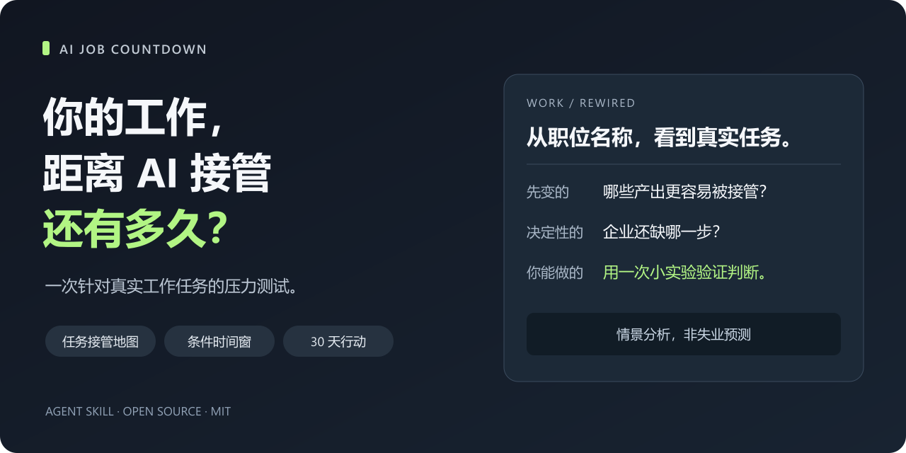

# AI Job Countdown · 工作倒计时

> **你的工作，距离 AI 接管还有多久？**

A task-based Agent Skill for exploring how AI may change your work, with conditional scenarios and a 30-day action plan.

从你每天真实做的事开始，找出最先变化的任务、仍需你负责的环节，以及值得观察的时间窗。把焦虑变成一项能验证的行动。



**先看同一个职位的两种工作：** [偏交付的产品经理](examples/product-manager-delivery.md) · [偏探索的产品经理](examples/product-manager-discovery.md)

你拿到的结论会像这样，而不是一张只有分数的测试结果：

> **“最先失去稀缺性的，可能是你每天花最多时间写的东西。”**  
> 交付型产品经理 · **虚构演示**  
> 下一验证点：标准 PRD 草案连续 4 周通过验收。  
> 基准规划：3–6 个月，前提是资料治理、只读接入与试点验收顺利。  
> 岗位整体替代：证据不足，无法估计。  
> 本月：做一组脱敏样本，比较包含返工与复核的总耗时。  
> **情景分析，非失业预测。**

## 复制这段话，开始体验

安装 Skill 后，在你的 Agent 中发送：

```text
使用 ai-job-countdown，帮我做一次“工作倒计时”分析。

先集中问我一轮：职位、行业、主要任务和时间占比、交付标准，
以及公司使用 AI 的限制。根据我的回答分析真实任务；
仍缺少依据的地方标明待验证，不要仅凭职位下判断。

给我任务接管现状、有前提的情景时间窗、会改变结论的信号，
以及有验收标准的 30 天行动。岗位编制变化单独判断。
最后生成匿名 Markdown 分享卡，留在当前对话中。
```

准备好最近一周的 3–7 项任务即可。描述任务的输入、交付物和谁负责验收，会比一个职位名称更有帮助。

## 安装

直接从 GitHub 安装：

```bash
npx skills add Singapo/ai-job-countdown --skill ai-job-countdown
```

也可以下载或克隆本仓库，进入仓库根目录后运行：

```bash
npx skills add . --skill ai-job-countdown
```

需要 Node.js/npm；按 CLI 提示选择目标 Agent。命令使用 Skills CLI 的[仓库来源、本地目录与指定 Skill 选项](https://github.com/vercel-labs/skills/blob/main/docs/commands.md)。不同宿主的 Skill 加载与联网能力可能不同。

也可以先阅读 [Skill 原文](skills/ai-job-countdown/SKILL.md)和[完整示例](examples/product-manager-delivery.md)，了解访谈与报告结构。

## 你会拿到什么

| 输出 | 帮你回答的问题 |
| --- | --- |
| 一句话结论 | 近期最值得关注的工作变化是什么？ |
| 任务接管表 | 哪些能由 AI 协作，哪些有条件代办，哪些已有代办证据，哪些仍由人主导，哪些待验证？ |
| 情景时间窗 | 同一项具体变化，在不同前提下可能何时出现？ |
| 岗位编制判断 | 任务变化是否有足够证据影响岗位数量或配置？ |
| 30 天行动 | 现在做什么实验，用什么结果验收？ |
| 匿名分享卡 | 如何用一小段 Markdown 展示判断和关键条件？ |

时间窗属于规划假设，从报告日期起算，围绕同一个可观察事件展开。例如，判断“固定周报由 AI 代办并通过既定验收”，需要明确数据权限、质量标准和采用条件。缺少依据时，结论就是“无法估计”，并给出下一步取证方式。

默认分享卡只在当前对话中生成。是否保存或分享由你决定；对话数据处理遵循所用宿主的设置与政策。

## 两个产品经理，为什么要分别分析

职位相同，实际工作可能差很多。整理需求、维护文档和跟进交付，与探索未知需求、协调利益冲突和做取舍，需要的证据与判断条件也不同。

| 示例 | 用来观察什么 |
| --- | --- |
| [偏交付的产品经理](examples/product-manager-delivery.md) | 文档与例行工作变得容易代办后，交付责任如何变化？ |
| [偏探索的产品经理](examples/product-manager-discovery.md) | 访谈整理变快后，问题选择与决策责任如何评估？ |

这两份是演示案例，用于展示分析方法；它们不能代表所有产品经理，也不构成实际就业预测。

## 方法与局限

分析分开看三件事：技术上能否完成任务、组织是否具备采用条件、是否有证据影响岗位编制。任务时间占比只描述你的工作结构，不能直接当作失业概率。

状态包括 **AI协作、条件可代办、已有代办证据、人主导、待验证**。判定条件、证据要求和时间窗规则见[方法说明](skills/ai-job-countdown/references/methodology.md)。

这是一套访谈与情景分析方法，尚未经过个体就业结果的预测校准。输出受任务描述、模型能力、来源质量和企业情况影响；没有证据支持的失业日期或精确概率，不应出现在报告里。无法联网或缺少近期证据时，应标明信息缺口；尚无实际使用记录的外部能力作为待测试假设。

方法背景来自以下公开资料，链接核验日期为 2026-10-23：

- [ILO 2025 年的任务级职业暴露研究](https://www.ilo.org/publications/generative-ai-and-jobs-refined-global-index-occupational-exposure)：提供从具体任务观察岗位变化的视角。
- [ILO 2026 年的暴露指标局限说明](https://www.ilo.org/publications/workers%E2%80%99-exposure-ai-what-indicators-tell-us-%E2%80%93-and-what-they-don%E2%80%99t)：暴露指标不能直接预测就业结果，企业采用与需求变化需单独分析。

本 Skill 的个体情景推演由本项目定义，不是 ILO 官方预测工具。

## 当前验证范围

已通过 Skill Creator 的结构检查，并核对内部链接、示例占比和封面显示。另做了[三项离线行为演练](evals/forward-test.md)，完整保留输入、实际回答和问题记录：强求准确失业概率、企业试点尚未开始、JD 夹带指令与匿名分享。

尚未执行 Skills CLI 安装与不同宿主的端到端验证，也未验证真实工具能力或时间窗预测准确性。安装语法依据上方官方文档，兼容范围以实际安装结果为准。

## 相关项目

创建前查看了这些已有方案，供需要不同分析方式的读者参考：

- [AI Career Threat Index](https://github.com/Jott2121/ai-career-threat-index)：侧重公开的职业评分数据集与探索工具。
- [AI Job Evolution Analyzer](https://github.com/bhoomika0529/AI-Job-Evolution-Analyzer)：侧重任务级影响分析、技能差距与职业发展建议。
- [Skills CLI](https://github.com/vercel-labs/skills)：提供本仓库采用的 Skill 安装方式。

本仓库交付的是可装入 Agent 的个人工作任务访谈 Skill，便于在现有对话中反复使用。未复制上述项目的数据或代码。

## 参与改进

欢迎提交匿名案例、反例、可核验的任务代办证据，或指出某条结论缺了什么前提。提交时附上任务描述、验收标准、实际观察和报告日期；移除姓名、公司、客户和内部资料。也欢迎改进访谈中的歧义与行动的验收方式。

如果它对你有用，可以 Star 收藏。发布文案和维护建议见[发布清单](docs/LAUNCH.md)。

[MIT License](LICENSE)
